# Viikko 6 -Zabbix ja keskitetty verkonvalvonta

## 1. Johdanto

### Mikä Zabbix on ja mihin sitä käytetään?

Zabbix on avoimen lähdekoodin verkon- ja järjestelmänvalvontaohjelmisto, jonka avulla voidaan seurata keskitetysti esimerkiksi palvelimien, verkkolaitteiden ja palveluiden toimintaa. Zabbix kerää tietoa muun muassa suorittimen kuormituksesta, muistin käytöstä, levytilasta ja verkkoliikenteestä. Kerättyjä tietoja voidaan tarkastella graafeina ja mittareina. Lisäksi Zabbixiin voidaan määrittää hälytyksiä, jotka ilmoittavat esimerkiksi liian suuresta kuormituksesta tai palvelun toimintahäiriöstä. Zabbixia käytetään verkkojen, palvelimien ja muiden IT-järjestelmien keskitettyyn valvontaan. Näin järjestelmien toimintaa voidaan seurata yhdestä paikasta ja ongelmiin voidaan reagoida mahdollisimman nopeasti.

Tämän harjoituksen tavoitteena oli tutustua Zabbixin käyttöliittymään, lisätä valvottavia laitteita, seurata niiden toimintaa sekä testata hälytysten toimintaa käytännössä.

### Zabbixin käyttöliittymään tutustuminen

Hosts -->  Voit lisätä valvottavia laitteita ja palvelimia, sekä hallita valvontamäärityksiä.

Templates -->  Valmiita määrityspohjia, jotka sisältävät esimerkiksi itemejä ja triggereitä. Yhtä templatea voidaan käyttää usealle hostille.

Monitoring -->  Voi tarkastella valvottavien laitteiden toimintaa, mittaustuloksia ja ongelmia.

Dashboards -->  Koontinäytölle voidaan koota eri mittareita, graafeja ja hälytyksiä valinnan mukaan.

Alerts -->  Voidaan hallita hälytyksiin liittyviä ilmoituksia ja automaattisia toimintoja.

Reports -->  Raportoidaan valvontatietoja ja järjestelmän toimintaa.

# 2. Hostin lisääminen

Zabbixiin lisättiin valvottaviksi hosteiksi Containerlab-ympäristön web1, db1 ja branch-client. Hosteille määritettiin nimet, laiteryhmä sekä Zabbix-agentin yhteystiedot. Alla olevassa kuvassa näkyvät web1-hostin asetukset.

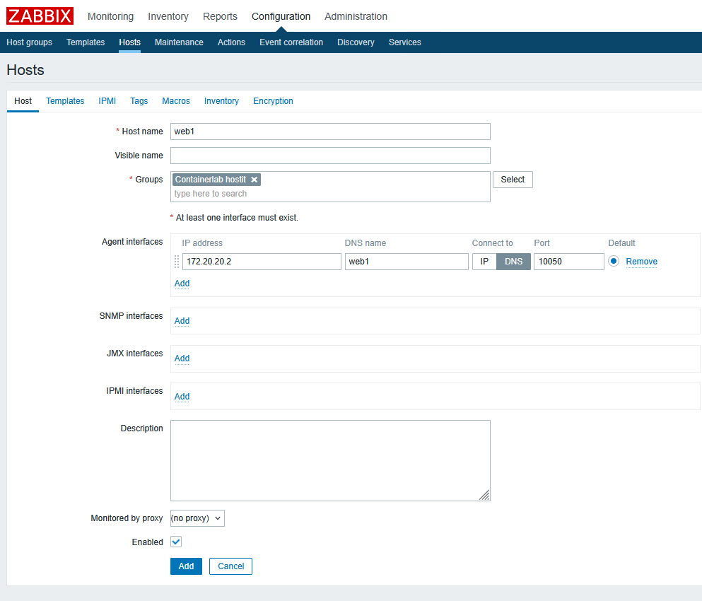

Hostille liitettiin valvontapohja Template OS Linux by Zabbix agent active. Valvontapohja sisältää valmiita mittareita ja hälytysehtoja, joiden avulla voidaan seurata esimerkiksi suorittimen kuormitusta, muistin käyttöä ja levytilaa.

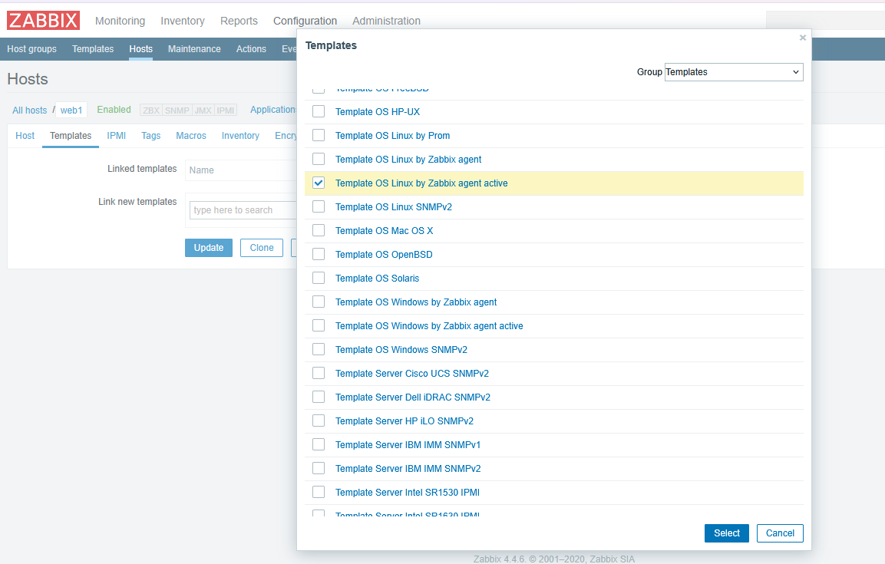

Zabbix-agentin asetustiedostossa määritettiin palvelimen osoite sekä hostin nimi. ServerActive-asetuksella määritettiin Zabbix-palvelimen osoite, johon agentti lähettää aktiivisten tarkistusten mittaustiedot. Hostname-arvon tulee vastata Zabbixiin määritettyä hostin nimeä.

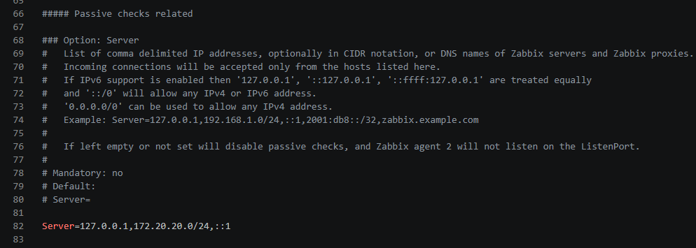

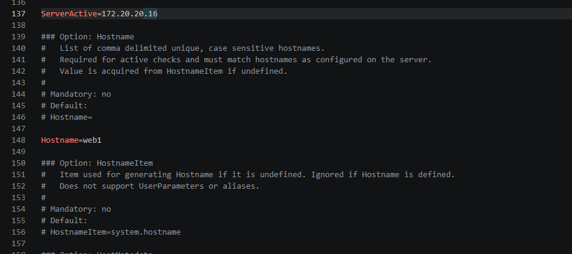

Hostien lisäämisen ja asetusten määrittämisen jälkeen tarkistettiin, että laitteet näkyvät Zabbixin Hosts-listalla.

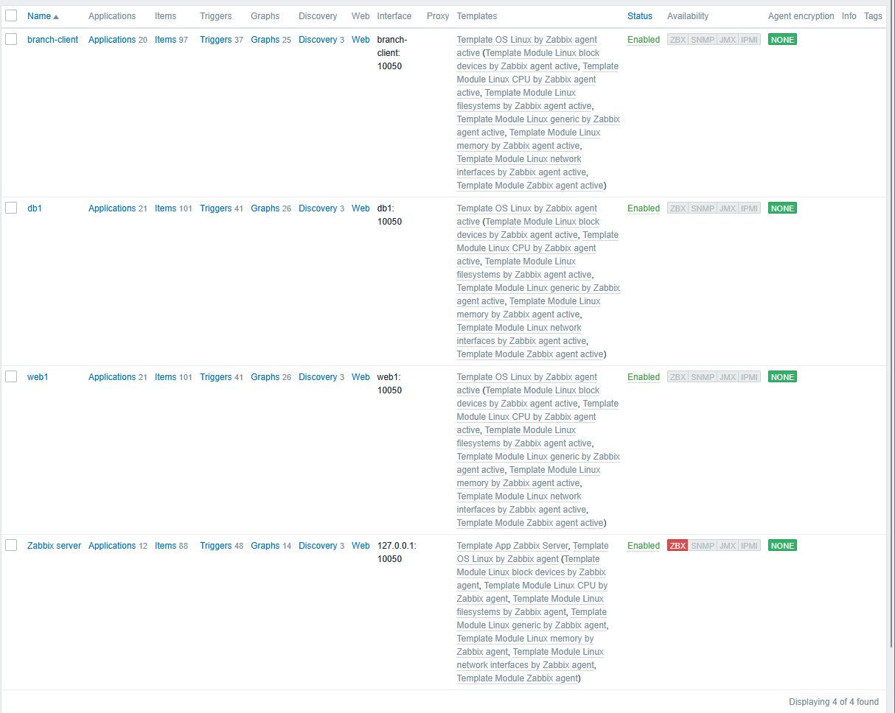

web1-hostin mittaustietoja Latest data -näkymässä:

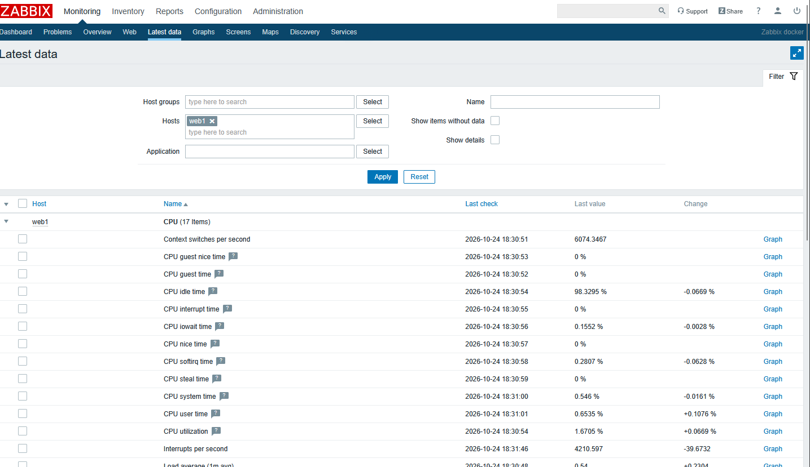

# 3. Dashboard

Loin Zabbixiin Golden Topology Status -dashboardin, johon kokosin kolmen valvottavan hostin CPU-kuormituksen, muistinkäytön, levytilan käytön ja verkkoliikenteen kuvaajat. Lisäksi dashboardilla näkyvät hostien tavoitettavuustiedot sekä CPU-mittausarvot taulukkomuodossa. Hostien tavoitettavuus näkyy Unknown-tilassa aktiivisen agenttivalvonnan vuoksi, vaikka mittaustiedot päivittyvät normaalisti.

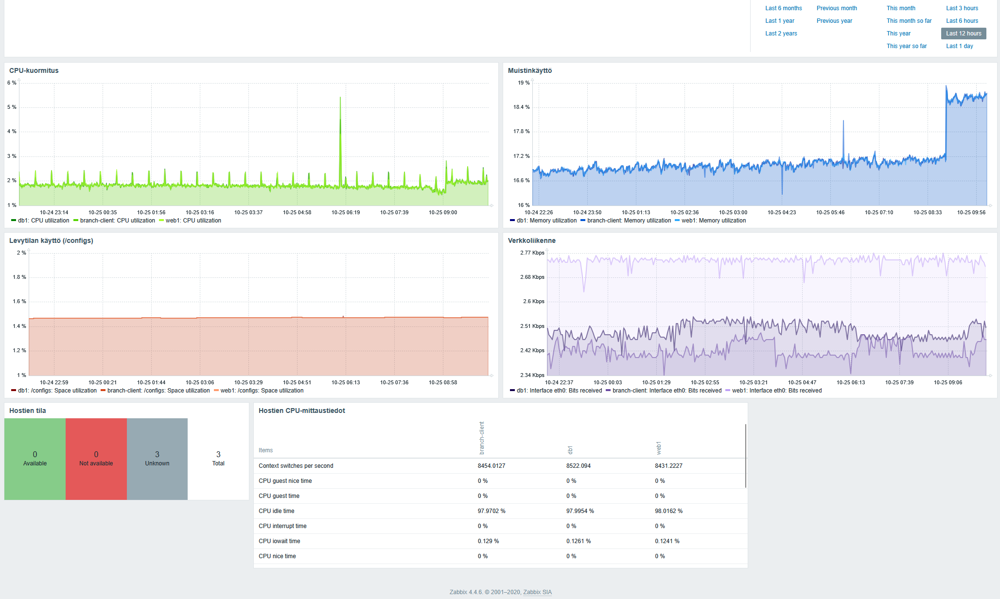

# 4. Mittarit

Valitsin tarkasteltavaksi viisi eri valvontamittaria Zabbixin branch-client-hostilta. Taulukossa on esitetty mittareiden arvot, niiden merkitys sekä lyhyt arvio mittaustuloksista.

| Mittari | Arvo | Merkitys |
|---|---|---|
| CPU utilization | 1.925 % | Kertoo suorittimen käyttöasteen. Seuraamalla tätä voidaan havaita, kuormittuuko suoritin liikaa hidastaen järjestelmän toimintaa. Mitattu käyttöaste on hyvin pieni, joten suoritin ei ole tällä hetkellä merkittävästi kuormittunut. |
| Memory utilization | 18,5759% | Kertoo keskusmuistin käyttöasteen. Mittarin avulla voidaan seurata muistin riittävyyttä ja havaita mahdollinen liiallinen muistinkulutus. Mitattu käyttöaste on melko pieni, joten muistia on hyvin käytettävissä. |
| Load average  (1m avg)| 0,3247 | Kertoo järjestelmän keskimääräisen kuormituksen viimeisen minuutin ajalta. Mittarin avulla voidaan havaita järjestelmän ruuhkautumista. Mitattu arvo on pieni, joten järjestelmä ei ole merkittävästi kuormittunut. |
| System uptime | 20:36:52 | Kertoo, kuinka kauan järjestelmä on ollut käynnissä. Mittarin avulla voidaan seurata järjestelmän toiminnan jatkuvuutta ja havaita mahdollisia uudelleenkäynnistyksiä. Mitattu arvo osoittaa, että järjestelmä on ollut käynnissä yli 20 tuntia. |
| Interface eth0: Bits received | 2,4Kbps | Kertoo verkkoliitännän vastaanottaman tiedon määrän sekunnissa. Mittarin avulla voidaan seurata verkkoliikenteen määrää ja havaita poikkeavaa liikennettä. Mitattu arvo on pieni, joten verkkoliikennettä on tällä hetkellä vähän. |

# 5. Triggerit

Loin branch-client-hostille kaksi triggeriä. Hälytysrajaksi asetetin aluksi 80 %, mutta laskin sen 5 prosenttiin, koska harjoitusympäristössä suorittimen kuormitus jäi niin alhaiseksi, ettei alkuperäinen hälytysraja ylittynyt. Näin saatiin testattua, että hälytys toimii.
Toinen triggeri antaa Warning-tason hälytyksen, jos käytetty levytila ylittää 80 % eli vapaata levytilaa on alle 20 %. Molemmat triggerit ovat käytössä (Enabled), ja niiden avulla voidaan havaita suorittimen liiallinen kuormitus sekä levytilan väheneminen.

# 6. Hälytys- ja häiriötestit

## Hälytystesti

CPU-kuormitusta simuloitiin branch-client-kontissa komennolla yes > /dev/null. Kuormituksen aikana suorittimen käyttöaste nousi noin 2 prosentista 8 prosenttiin. Kuormituksen kasvu näkyi myös db1- ja web1-hostien mittaustiedoissa, koska kontit käyttävät samaa Linux-ydintä ja Zabbixin mittari seuraa järjestelmän kokonaiskuormitusta.

Zabbix havaitsi 5 prosentin hälytysrajan ylittymisen ja laukaisi High-tason hälytyksen arviolta 20 sekunnin kuluttua. Hälytys näkyi Monitoring → Problems -näkymässä. Kuormituksen lopettamisen jälkeen suorittimen käyttöaste palautui normaalille tasolle. Testin perusteella Zabbixin hälytystoiminto toimi odotetusti.

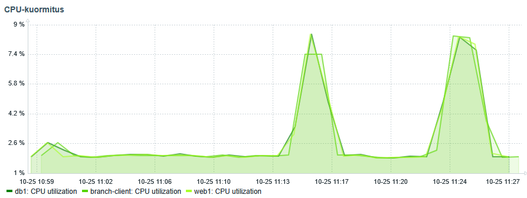

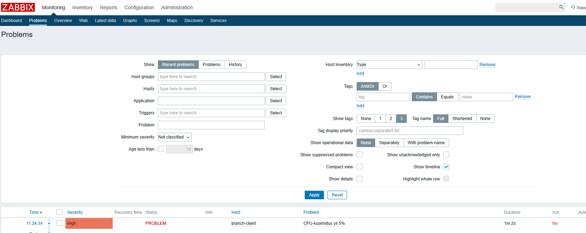

## Häiriötesti

Palveluhäiriön testaamisessa oli tarkoitus pysäyttää Apache-palvelin tai Node Exporter. web1-kontin käynnissä olevista prosesseista ei kuitenkaan löytynyt kumpaakaan palvelua johtuen ympäristön resetoinnistani. Sen sijaan kontissa oli käynnissä Zabbix-agentti, joten häiriö toteutettiin pysäyttämällä se. Näin pystyin testata, miten Zabbix reagoi tilanteeseen, jossa valvottavalta hostilta ei enää saada mittaustietoja.

Agentin pysähtymisen varmistin komentoriviltä. Zabbix ei reagoinut häiriöön välittömästi, joten tarkistetin triggerin asetuksista hälytyksen aikarajan. Aikarajaksi oli määritetty 30 minuuttia, jonka kuluttua Problems-näkymään ilmestyi Average-tason hälytys.

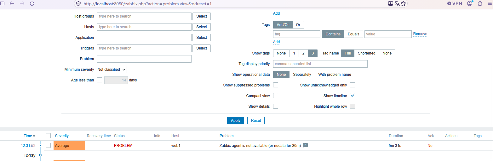

Zabbix muodosti hälytyksen, kun agentilta ei ollut saatu mittaustietoja 30 minuuttiin. Agentin uudelleenkäynnistyksen jälkeen hälytys poistui nopeasti, kun Zabbix alkoi jälleen vastaanottaa mittaustietoja. Hälytyksen muodostuminen vaati siis 30 minuutin katkoksen, mutta palautuminen tapahtui ilman vastaavaa odotusaikaa.

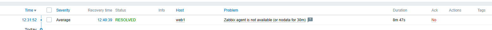

# 7. Vertailu

| Ominaisuus | SNMP | Prometheus | Zabbix |
|---|---|---|---|
| Tiedonkeruu | Kyselyt ja trap-ilmoitukset verkkolaitteilta | Kerää mittaritiedot yleensä HTTP-rajapinnan kautta | Agentit, SNMP ja muut tiedonkeruutavat |
| Dashboardit | Ei omaa dashboardia | Perusnäkymät, usein Grafana | Sisäänrakennetut dashboardit |
| Hälytykset | Trap-ilmoitukset, hälytyslogiikka erillisessä järjestelmässä | Hälytyssäännöt ja Alertmanager | Sisäänrakennetut triggerit ja hälytykset |
| Käyttöönotto | Vaatii SNMP-asetukset ja valvontaohjelman | Vaatii palvelimen ja tiedonkeruun määrittämisen | Vaatii palvelimen, hostit ja valvontapohjat |
| Skaalautuvuus | Riippuu valvontajärjestelmästä | Hyvä, erityisesti kontti- ja pilviympäristöissä | Hyvä, tukee laajoja ympäristöjä |
| Yrityskäyttö | Verkkolaitteiden valvonta | Sovellusten, palveluiden ja konttien valvonta | Verkkojen, palvelimien ja IT-palveluiden keskitetty valvonta |

# 8. Yhteenveto

Kurssin aikana tutustuttiin useisiin verkonhallinnan työkaluihin ja menetelmiin, jotka olivat minulle entuudestaan lähes täysin uusia. Erityisesti ensimmäisellä viikolla oli vaikea hahmottaa, mitä olimme tekemässä ja miten eri ohjelmistot liittyivät toisiinsa. Kurssin edetessä aikaisempien harjoitusten tarkoitus on kuitenkin alkanut selkiytyä, kun samoja työkaluja ja menetelmiä on hyödynnetty myöhemmissä tehtävissä.

Keskitetyn verkonvalvonnan suurimpana hyötynä pidän sitä, että useiden laitteiden ja palveluiden toimintaa voidaan seurata yhdestä paikasta. Tärkeimpiä seurattavia mittareita ovat mielestäni suorittimen kuormitus, muistin käyttö, levytilan riittävyys ja verkkoliikenne. Näistä olisi hyvä saada myös automaattisia hälytyksiä, jotta mahdollisiin ongelmiin voidaan puuttua ennen kuin ne aiheuttavat varsinaisia toimintahäiriöitä. Hälytysrajat tulisi määrittää ympäristön ja sen normaalin kuormituksen perusteella siten, että ylläpitäjälle jää riittävästi aikaa reagoida.

Prometheus soveltuu erityisesti mittaritietojen keräämiseen esimerkiksi konttiympäristöissä, ja Grafanan avulla tietoja voidaan esittää selkeinä graafeina. Zabbix puolestaan soveltuu laajempaan keskitettyyn valvontaan, jossa voidaan seurata laitteiden toimintaa ja määrittää niille hälytyksiä suoraan samassa järjestelmässä. Tämän harjoituksen perusteella Zabbixin hälytysominaisuudet olivat mielestäni erityisen hyödyllisiä.

Kehittäisin harjoitusympäristön valvontaa siten, että jokaisen kontin resurssien käyttöä voitaisiin seurata erikseen. Nyt esimerkiksi CPU-kuormitus näytti perustuvan konttien yhteisen ympäristön tietoihin, jolloin yksittäisen kontin aiheuttamaa kuormitusta oli vaikea erottaa muiden kuormituksesta. Konttikohtainen valvonta antaisi tarkemman kuvan siitä, missä mahdollinen ongelma syntyy.

Kurssin tärkeimpänä oppina pidän kokonaiskuvan muodostumista siitä, miten dokumentointi, automatisointi, infrastruktuurin hallinta koodina (IaC), tiedonkeruu ja valvonta liittyvät toisiinsa. Näiden avulla voidaan vähentää käsin tehtäviä määrityksiä ja inhimillisiä virheitä sekä parantaa verkon hallittavuutta, tietoturvaa ja toimintavarmuutta. Vaikka kurssilla on tullut vastaan paljon uutta termistöä ja ohjelmistoja, niiden merkitys ja yhteydet toisiinsa ovat alkaneet hahmottua paremmin kurssin loppua kohden.